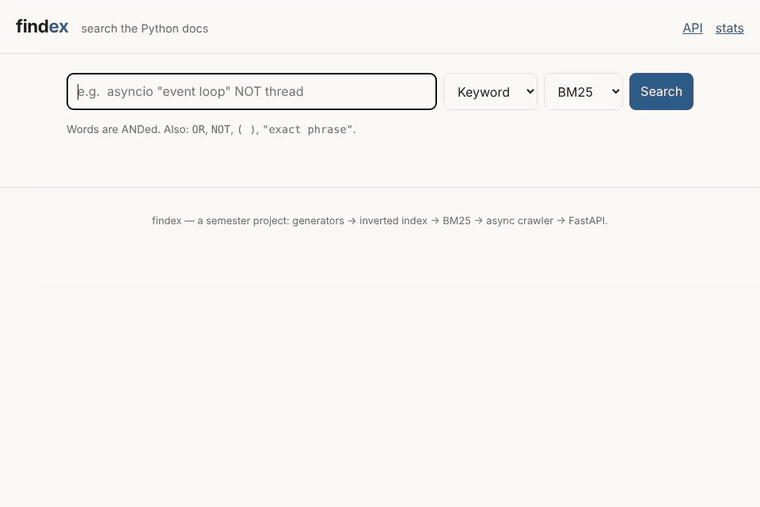
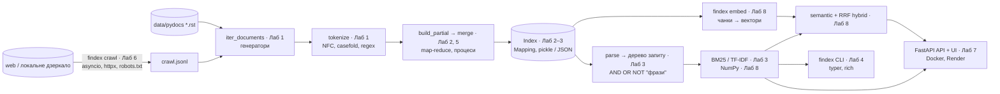
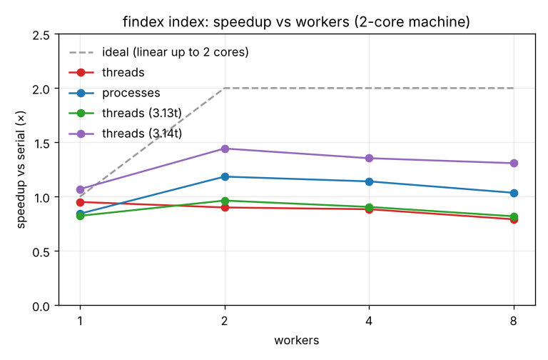
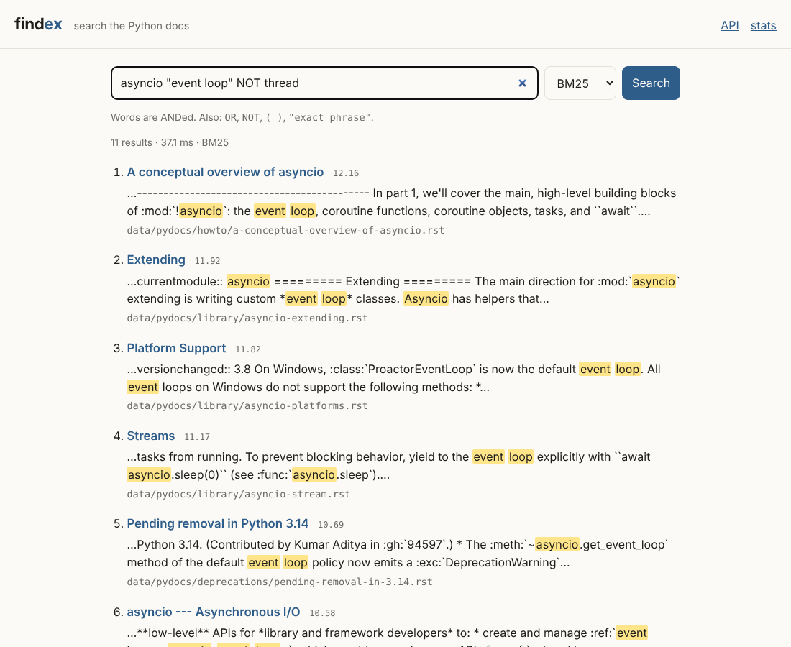

# findex — пошукова система по документації Python, зібрана з нуля

[](https://github.com/USERNAME/findex/actions/workflows/ci.yml)

**findex** — повнотекстовий і семантичний пошук по 560 сторінках документації Python:
інвертований індекс, BM25, мова запитів з фразами, асинхронний краулер, веб-API і UI —
усе написано власноруч за 8 лабораторних курсу «Python програмування».

**Live:** https://findex-USERNAME.onrender.com · **API:** [/docs](https://findex-USERNAME.onrender.com/docs) · **Демо-відео (2–3 хв):** *посилання додати*



| | |
|---|---|
| **Корпус** | 560 документів, 13 МБ, 1,8 млн токенів, 42 724 терміни |
| **Найбільші прискорення** | сніпети ×17 (O(h²) → O(h)), NumPy-скорер ×10 на корпусі і ×23 на 100 тис. постінгів, краулер ×15 (concurrency 20 vs 1) |
| **Затримка API** | 18 мс CPU на запит; p99 817 мс при 50 одночасних клієнтах на 2 ядрах (4 воркери) |
| **Якість** | P@5: BM25 0,52 → гібрид 0,54 (10 запитів); на перефразуваннях 0,16 → 0,20 |
| **Тести** | 154 (pytest + Hypothesis + pytest-benchmark), покриття 85 %, pyright strict — 0 помилок |

## Як це влаштовано



## Швидкий старт

```bash
./scripts/get_corpus.sh                                  # корпус -> data/pydocs/ (не комітиться)
uv sync                                                   # або: uv tool install .
uv run findex index data/pydocs --out data/index.pkl --positions
uv run findex search data/index.pkl 'asyncio "event loop" NOT thread' -k 5
uv run findex embed data/index.pkl --model lsa           # або all-MiniLM-L6-v2 (pip install 'findex[semantic]')
uv run findex search data/index.pkl "send mail from a script" --mode hybrid
uv run findex serve --index data/index.pkl               # http://127.0.0.1:8000  (API: /docs)
```

Розробка: `uv run pytest`, `uv run ruff check .`, `uv run pyright`.
Підтримуються будь-який каталог з `.txt`/`.md`/`.rst` і JSON-lines (`.jsonl`, `.jsonl.gz`).

## Усі вимірювання в одному місці

| Лаба | Що міряли | Результат |
|---|---|---|
| 1 | Пікова пам'ять статистики корпусу: списки vs генератори | 113,9 МБ → 4,5 МБ |
| 2 | Пам'ять постінгів: `dataclass` / `slots` / `array('I')` | 40,1 / 27,6 / 16,5 МБ |
| 2 | Перетин списків: merge vs `set` | `set` швидший у 2–8× (C проти байткоду) |
| 3 | P@5, 10 розмічених запитів: TF-IDF vs BM25 | 0,48 vs 0,52 |
| 4 | Покриття тестами | 82 % (65 тестів) → 85 % (154) у Лаб 8 |
| 5 | Індексація, 2 ядра: threads / processes / 3.14t threads | 0,90× / 1,18× / 1,44× |
| 5 | Гонка зі спільним `Counter` без GIL | 11–13 тис. втрачених оновлень; 0 з GIL |
| 5 | I/O-bound: 64 HTTP-запити, 32 потоки | ×25 |
| 6 | Краулер, 300 сторінок: concurrency 1 / 5 / 20 | 18 / 87 / 279 сторінок/с |
| 7 | `/search` під навантаженням: `async def` / `def` / 4 воркери | 64 / 55 / 118 RPS; `/health` p50 321 / 102 / 8 мс |
| 8 | Завантаження індексу / сніпети / токенізація | 1,32 → 0,43 с; 1,32 → 0,076 с; 1,04 → 0,80 с |
| 8 | Скорер Python vs NumPy (корпус / 100 тис. постінгів) | до ×10 / ×23, ранжування ідентичне |
| 8 | P@5 keyword / semantic (LSA) / hybrid, 15 запитів | 0,40 / 0,36 / 0,43 |

## Обмеження і що далі

- **Корпус малий** (560 документів): паралельність і NumPy виграють помірно; на 2 ядрах
  прискорення обмежене 2×. Скрипти бенчмарків відтворюють усі таблиці на іншій машині.
- **Індекс — у пам'яті й у pickle**: завантаження ~0,4 с, кожен воркер uvicorn тримає копію.
  Далі: `np.memmap` постінгів на диску і стиснуті (gap-encoded) списки.
- **Семантика тут — LSA** (TF-IDF + SVD), бо в середовищі розробки не було доступу до моделей;
  MiniLM підключається одним параметром (`--model all-MiniLM-L6-v2`), оцінку треба перезапустити.
- **Пошук «зіставлення» — ще Python**: на 100 тис. постінгів час іде вже не в скоринг, а в
  перетворення списку збігів у масив — наступна ціль для NumPy (Амдал знову).
- Немає стемінгу і стоп-слів: `messages` ≠ `message`; HTML-сторінки краулера індексуються без
  розмітки, але RST-розмітка документації (`:mod:`) лишається в сніпетах.
- Краулер не відновлюється після перерви (немає збереженого фронтиру) і не робить умовних
  запитів (`ETag`).

---

# Журнал лабораторних

## Лаб 1 — Ітератори, генератори та корпус

### Що зроблено

- `src/findex/corpus.py` — `iter_documents(root) -> Iterator[Document]`, **генератор**:
  відкриває один файл, віддає `Document(doc_id, path, text, title)`, переходить до наступного.
  Біті UTF-8 байти не валять програму: пишеться попередження в лог, байти замінюються на `�`.
- `src/findex/tokenize.py` — `tokenize(text) -> Iterator[str]`: NFC → `re.finditer` → `casefold`.
- `src/findex/stats.py` — однопрохідна статистика: `python -m findex.stats data/pydocs [--limit N] [--eager]`.
  `--limit` реалізовано через `itertools.islice`.
- `tests/test_tokenize.py` — 11 перевірок (регістр, `ß`, кирилиця, комбінований акцент, пунктуація,
  порожній рядок, апострофи, дефіси, цифри, підкреслення, «це генератор»).

Доказ лінивості: `next(iter_documents(Path("data/pydocs")))` повертається за ~9 мс — читається лише
перший файл; `inspect.isgeneratorfunction(tokenize)` → `True`.

### Правила токенізації

| Випадок | Правило | Приклад |
|---|---|---|
| Слова | послідовності `\w` (літери будь-якої абетки, цифри, `_`) | `Привіт` → `привіт` |
| Регістр | `casefold()`, а не `lower()` | `Straße` → `strasse` = `STRASSE` |
| Unicode | спочатку NFC | `cafe`+U+0301 → `café` |
| Апострофи | всередині слова зберігаються, `’` `ʼ` уніфікуються в `'` | `п’ять` → `п'ять`, `don't` |
| Дефіси | розділяють слова | `free-threaded` → `free`, `threaded` |
| Цифри | окремі токени | `3.13` → `3`, `13` |
| Підкреслення | зберігаються в ідентифікаторах; токен лише з `_` відкидається | `__init__` |

### Результат на повному корпусі

```
documents   : 560
tokens      : 1,807,392
vocabulary  : 42,724
top: the 98,852 · a 41,130 · to 36,658 · is 34,227 · of 29,096 · …
```

### Вимірювання: жадібна vs лінива версія

Той самий корпус (560 документів), Python 3.13, `tracemalloc`:

| Версія | Документів | Пікова пам'ять | Час |
|---|---|---|---|
| eager (списки) | 560 | 113,9 МБ | 12,1 с |
| lazy (генератори) | 560 | 4,5 МБ | 9,6 с |

*(Час виміряно під `tracemalloc`, який сповільнює виконання в кілька разів; співвідношення між
версіями від цього не змінюється.)*

**Куди пішла пам'ять.** Жадібна версія спершу читає *увесь* корпус у список (~13 МБ тексту
одразу), а потім будує список списків токенів: 1,8 млн окремих об'єктів `str`, кожен ~50–60 байт
плюс 8-байтовий вказівник у списку — це і є основні ~100 МБ. Лінива версія в кожен момент тримає
лише **один документ** і **один поточний токен**; єдине, що росте, — `Counter` зі словником
(42 724 унікальних терміни → кілька МБ). Тому її пам'ять не нульова: вона дорівнює «найбільший
документ + Counter» і не залежить від розміру корпусу. Лінива версія ще й швидша, бо не
створює і не прибирає мільйони проміжних об'єктів.

---

## Лаб 2 — Інвертований індекс: словники, хешування, пам'ять

### Що зроблено

- `src/findex/models.py` — `Posting(doc_id, tf, positions)` і `DocMeta(doc_id, path, title)`:
  `@dataclass(frozen=True, slots=True)` → незмінні, хешовані (можна класти в `set`), без `__dict__`.
- `src/findex/index.py` — `build_index(docs, positions=False)`: **один прохід** по ліниво
  прочитаному корпусу. Для кожного документа рахується його власний `Counter`, після закінчення
  документа він «скидається» в `defaultdict(list)` постінгів. Документи надходять у порядку
  зростання `doc_id`, тому постінги відсортовані автоматично. Прапорець `--positions` зберігає
  позиції токенів (знадобляться для фразового пошуку в Лаб 3).
- `src/findex/search.py` — булевий пошук `a b` (AND), `OR`, `NOT` зліва направо;
  **two-pointer merge** для AND/OR/NOT і альтернативний рушій на `set` (`--engine merge|set`).
- `src/findex/store.py` — `save`/`load` у двох форматах: **pickle** (`.pkl`) і **JSON** (`.json`).
- `scripts/lab02_measure.py` — усі вимірювання нижче.

```bash
uv run python -m findex.index data/pydocs --out index.pkl            # build + save
uv run python -m findex.index data/pydocs --out index.pkl --positions
uv run python -m findex.search index.pkl "asyncio event loop NOT thread"
uv run python -m findex.search index.pkl "slots OR dataclass" --engine set
uv run python scripts/lab02_measure.py data/pydocs
```

Індекс: 560 документів, 42 724 терміни, 331 649 постінгів.

> ⚠️ **Чому pickle небезпечний.** Файл pickle — це не дані, а програма для віртуальної машини
> pickle: він може попросити завантажувач викликати будь-яку функцію, яку можна імпортувати
> (наприклад, `os.system("...")`) через `__reduce__`. Тому `pickle.load` на завантаженому з
> інтернету файлі — це віддалене виконання коду. Ми завантажуємо лише індекси, які зібрали самі.

### Дослідження пам'яті (центральна таблиця)

| Представлення постінгів | Пікова пам'ять (build) | Розмір файлу | Час завантаження |
|---|---|---|---|
| `list[Posting]`, звичайний `@dataclass` | 40,1 МБ | 7,5 МБ | 0,74 с |
| `list[Posting]`, `slots=True` | 27,6 МБ | 5,6 МБ | 0,76 с |
| пари `array('I')` (doc_ids, tfs) — без об'єктів | 16,5 МБ | 4,4 МБ | 0,05 с |

**Куди пішли байти.** Звичайний екземпляр dataclass — це об'єкт 48 Б **плюс** власний `__dict__`
(~96 Б), де зберігаються атрибути; на 331 тис. постінгів це десятки МБ лише на словники.
`slots=True` прибирає `__dict__`: атрибути лежать у фіксованих C-слотах, об'єкт важить 56 Б.
Але навіть тоді кожен постінг — це окремий Python-об'єкт (заголовок з лічильником посилань і
типом) + 8-байтовий вказівник у списку + об'єкти `int`. Пара `array('I')` взагалі не створює
об'єктів: кожне число — це 4 «сирі» байти, тож на постінг припадає 8 Б замість ~70.
Решта пам'яті в третьому рядку — це сам словник термінів (42 тис. рядків-ключів).
Завантаження масивів у 15 разів швидше, бо pickle копіює суцільний буфер байтів, а не
відтворює сотні тисяч об'єктів.

### Формати збереження (повний індекс, без позицій)

| Формат | Розмір файлу | Збереження | Завантаження |
|---|---|---|---|
| pickle | 5,6 МБ | 1,20 с | 1,35 с |
| JSON | 4,1 МБ | 1,57 с | 1,06 с |

JSON вийшов навіть меншим: pickle для кожного `Posting` пише інструкцію «створи об'єкт класу»
зі станом, а JSON — лише `[doc_id, tf, []]`. З позиціями індекс у pickle росте з 5,6 до 11,1 МБ
(у 2 рази), а пікова пам'ять побудови — з 28 до 99 МБ.

### merge vs set

| Терміни (df) | Операція | merge | set |
|---|---|---|---|
| `in` (536) · `the` (552) | AND | 56,7 µs | 22,3 µs |
| `in` (536) · `the` (552) | OR | 58,2 µs | 20,8 µs |
| `offline` (3) · `distributable` (3) | AND | 0,4 µs | 0,3 µs |
| `the` (552) · `offline` (3) | AND | 46,5 µs | 5,6 µs |

Асимптотично merge — O(len(a)+len(b)), set — теж O(len(a)+len(b)) (побудова хеш-таблиць).
Але в CPython цикл merge виконується байткодом інтерпретатора (кожен крок — кілька операцій
VM), а `set(a) & set(b)` повністю написаний на C, тому на наших маленьких списках (≤ 560 doc_id)
set швидший у 2–8 разів. На однакових крихітних списках різниці майже немає. Merge виграє там,
де set неможливий або дорогий: постінги на диску / стиснуті / не влазять у пам'ять (merge
працює потоково), а також для фразового пошуку по позиціях. Найбільший розрив — коли один
список значно довший (`the` vs `offline`): тут допоміг би «галопуючий» пошук (бінарний пошук
по довгому списку) замість лінійного проходу.

---

## Лаб 3 — Рейтинг і модель об'єктів

### Що зроблено

- **`Index` — справжній Python-об'єкт** (`src/findex/index.py`): успадковує
  `collections.abc.Mapping[str, list[Posting]]` і реалізує `__getitem__`, `__len__`, `__iter__`
  (решта — `get`, `keys`, `items`, `__contains__` — приходить від `Mapping`; `__contains__`
  перевизначено як швидший). Також `__repr__`, `__eq__`, властивості `num_docs` (`@property`),
  `avg_doc_length` і `all_doc_ids` (`@cached_property` — обчислюються один раз), методи
  `doc_length`, `df`, `idf`.
- **`open_index(path)`** — контекстний менеджер через `@contextmanager` (`store.py`): індекс
  звільняється в `finally`, навіть якщо тіло `with` кинуло виняток.
- **`Scorer` — протокол** (`scoring.py`), дві незалежні реалізації без спільного предка:
  `TfIdf` і `BM25(k1=1.5, b=0.75)`; обидві мають `__call__`.
- **`SearchEngine.search(query, k)`** (`search.py`): дерево запиту визначає *які* документи
  підходять, скорер — *порядок*, `heapq.nlargest(k, …)` бере top-k за O(n log k).
  Результати — `SearchResult` з `@dataclass(order=True)`.
- **Мова запитів** (`query.py`): рекурсивний спуск, вузли `Term`, `Phrase`, `And`, `Or`, `Not`
  (заморожені dataclass-и → порівнюються як дерева) з перевантаженими `&`, `|`, `~`.
  Фрази шукаються по позиціях тим самим two-pointer merge.
- **`@timed`** (`decorators.py`, з `functools.wraps`) на `build_index`, `load`, `save`,
  `SearchEngine.search`; **`functools.lru_cache(maxsize=256)`** на шляху «рядок запиту →
  doc_ids»; `parse` теж кешується.
- **Сніпети** (`snippets.py`): вікно ±80 символів навколо позиції, що покриває найбільше
  різних термінів запиту, межі розширюються до цілих слів, терміни підсвічуються.

```python
>>> with open_index(Path("index.pkl")) as ix:
...     print(repr(ix), len(ix), "python" in ix, ix.df("python"), round(ix.avg_doc_length, 1))
Index(terms=42_724, docs=560, positions=True) 42724 True 460 3227.5
>>> parse("python (async OR await) NOT java") == Term("python") & (Term("async") | Term("await")) & ~Term("java")
True
```

```bash
uv run python -m findex.index data/pydocs --out index.pkl --positions
uv run python -m findex.search index.pkl 'asyncio "event loop" NOT thread' --k 5 --repeat 2 -vv
uv run python scripts/lab03_evaluate.py data/pydocs
```

Лог із кеш-попаданням на повторному запиті (`-vv`):

```
findex.timing: load took 1116.2 ms
findex.timing: SearchEngine.search took 1.2 ms
__main__: cache hit for 'asyncio "event loop" NOT thread'
findex.timing: SearchEngine.search took 0.3 ms
```

> Пастка, на яку ми натрапили: під `python -m findex.index` файл виконується як модуль
> `__main__`, і pickle записував клас як `__main__.Index` — такий файл не завантажувався з
> інших модулів. Виправлено: блок `if __name__ == "__main__"` імпортує справжній
> `findex.index` і викликає його `main()`.

### Три перевірки ранжування (на нашому корпусі)

**1. Рідкісний термін переважає частий.** Запит `the OR zipapp`: `df(the)=552`, `df(zipapp)=8`.
Найкращий документ із `zipapp` (`library/zipapp.rst`) — **9,97**; найкращий лише з `the` — **0,04**.
`idf(the)=0,015` проти `idf(zipapp)=4,19`.

**2. BM25 насичує tf.** Вага терміна для документа середньої довжини:

| tf | вага BM25 | внесок цього входження | вага TF-IDF |
|---|---|---|---|
| 1 | 1,000 | +1,000 | 1,000 |
| 2 | 1,429 | +0,429 | 1,693 |
| 5 | 1,923 | +0,105 | 2,609 |
| 10 | 2,174 | +0,031 | 3,303 |
| 20 | 2,326 | **+0,009** | 3,996 |

20-те повторення додає 0,009 — майже нічого; стеля BM25 = `k1 + 1 = 2,5`. TF-IDF росте без межі.

**3. Короткий документ з одним збігом переважає довгий.** Термін `regenerates`, tf=1 в обох:
`README.rst` (758 токенів) — BM25 **7,36**; `whatsnew/2.7.rst` (17 556 токенів) — BM25 **1,61**.
TF-IDF дає обом однакові 4,94, бо не враховує довжину.

### precision@5 (10 запитів, розмічених вручну)

Для кожного запиту вручну визначено файли документації, які *мають* бути в топ-5
(`scripts/lab03_evaluate.py`, словник `QRELS`). Слова запиту з'єднуються через `OR`.

| Запит | TF-IDF P@5 | BM25 P@5 |
|---|---|---|
| asyncio event loop | 0,6 | 0,8 |
| regular expression | 0,4 | 0,4 |
| unicode normalization | 0,4 | 0,4 |
| logging handler | 1,0 | 1,0 |
| descriptor | 0,4 | 0,2 |
| dataclass frozen | 0,2 | 0,2 |
| garbage collection reference cycles | 0,4 | 0,4 |
| serialize objects | 0,4 | 0,6 |
| thread pool executor | 0,4 | 0,4 |
| command line arguments parser | 0,6 | 0,8 |
| **середнє** | **0,48** | **0,52** |

BM25 трохи кращий (особливо там, де релевантні документи короткі й сфокусовані). Для запитів
з 1–2 релевантними файлами (`dataclass frozen`, `regular expression`) P@5 обмежений зверху
0,2–0,4 самою кількістю релевантних документів — вибірка маленька й шумна, але звичка
вимірювати ранжування важливіша за саме число.

---

## Лаб 4 — Типи, тести, пакування, CLI

### Що зроблено

- **Типи, pyright strict — 0 помилок.** Усі публічні функції анотовані; генератори повертають
  `Iterator[...]`, приймають `Iterable[...]`; `Literal["bm25", "tfidf"]` і `Literal["merge", "set"]`
  для імен; `type DocIds = list[int]` (PEP 695); `@timed` типізовано через `ParamSpec`
  (`def timed[**P, R](fn: Callable[P, R]) -> Callable[P, R]`); `Scorer` — `typing.Protocol`;
  форма JSON-файлу — `TypedDict`. Єдиний `# type: ignore` — `__hash__ = None` в `Index`
  (свідомо робимо змінюваний контейнер нехешованим; коментар поруч).
- **pytest: 65 тестів**, з них **5 властивостей Hypothesis** (`tests/test_properties.py`,
  `tests/test_tokenize.py`): merge збігається з операціями над `set`; постінги завжди
  відсортовані; `load(save(index)) == index` (pickle і JSON); обчислення випадкового дерева
  запиту збігається з «оракулом» на множинах; токенізація ідемпотентна і не дає порожніх токенів.
  `conftest.py` створює маленький корпус (зокрема кирилицю і файл з битим UTF-8) один раз на
  сесію. Тест round-trip позначено `@pytest.mark.slow` (`uv run pytest -m "not slow"`).
  CLI тестується через `typer.testing.CliRunner`.
- **Пакет.** `pyproject.toml` (PEP 621): залежності `typer`, `rich`; група `dev`;
  `[project.scripts] findex = "findex.cli:app"`; конфіги ruff, pyright, pytest, coverage.
  `uv build` → `dist/findex-0.4.0-py3-none-any.whl`. Перевірено: у чистому venv
  встановлення wheel створює команду `findex`, і `findex --version` працює.
- **CLI** (`src/findex/cli.py`, typer + rich): `findex index` (смуга прогресу), `findex search`
  (таблиця rich з підсвіченими сніпетами; `--json` — JSON-рядки в stdout для `| jq`),
  `findex stats`; `-v` / `-vv` — рівень логів. Діагностика (логи, прогрес, помилки) йде в
  **stderr**, дані — в **stdout**. Очікувані помилки (немає файлу, зламаний запит, не той формат)
  — один рядок `error: …` і код виходу 1, без traceback.
- **logging**: `log = logging.getLogger(__name__)` у модулях; налаштування — лише один раз у
  `cli.py` (`RichHandler` → stderr); лінивий формат `log.info("indexed %d documents", n)`.
- **CI**: `.github/workflows/ci.yml` — на push і PR, Python 3.12 і 3.13: `uv sync --locked`,
  `ruff check`, `ruff format --check`, `pyright`, `pytest --cov`.

```bash
findex search index.pkl 'dataclass frozen' -k 2 --json | jq -r .title
findex search nope.pkl x ; echo $?        # error: index file not found: nope.pkl → 1
```

### Покриття: 82 %

| Модуль | Покриття | Що не покрито і чому |
|---|---|---|
| merge, tokenize, models, decorators | 100 % | — |
| cli, store | 96–97 % | гілки помилок, які важко відтворити (немає прав на файл) |
| query, scoring | 91–94 % | `__str__` вузлів для виводу, частина гілок помилок парсера |
| corpus, snippets | 83–87 % | помилка читання файлу (`OSError`), сніпети з `.jsonl.gz` |
| index, search | 69–76 % | навчальні `python -m findex.index/search` (`argparse`) з Лаб 2–3 — замінені CLI |
| stats | 0 % | `python -m findex.stats` з Лаб 1 — скрипт вимірювань, логіку покривають тести індексу |

Покриття — не мета саме по собі: важливі шляхи (токенізація, merge, парсер, скорери,
збереження, CLI) покриті тестами з гострими перевірками і властивостями.

---

## Лаб 5 — Конкурентність і GIL: паралельна побудова індексу

### Що зроблено

- **Map-reduce** (`src/findex/parallel.py`): корпус ділиться на шматки *шляхів*
  (`Chunk(root, start, paths)`), кожен шматок наперед отримує свій діапазон `doc_id`.
  `build_partial(chunk) -> PartialIndex` — функція рівня модуля (отже, її можна передати
  в інший процес через pickle); `merge(partials) -> Index` склеює постінги в порядку `doc_id`.
- **Компактна передача.** Перша версія повертала з воркерів готові об'єкти `Posting`:
  їх pickle/unpickle займав **2,1 с — більше, ніж уся побудова (1,4 с)**. Тепер воркер
  повертає плоскі буфери `array('I')` (`doc_ids`, `tfs`, `offsets`): серіалізація —
  0,01 с, а об'єкти `Posting` створює `merge` у батьківському процесі (~0,15 с).
- `findex index --executor {serial,threads,processes} --workers N`. Той самий
  `build_partial`/`merge` під звичайним циклом, `ThreadPoolExecutor` і `ProcessPoolExecutor`.
  За замовчуванням — `processes` (на GIL-збірці він виграє).
- **Побайтово однакові індекси** з усіх трьох виконавців (тест `test_all_executors_byte_identical`
  порівнює `pickle.dumps`), а `merge([build_partial(all)])` == індекс із Лаб 4.
- **Помилка у воркері** не зависає: `fut.result()` повторно кидає виняток, решта задач
  скасовується, оригінальний traceback воркера приходить як `__cause__` (тест).
- **Без `fork`.** Пул процесів стартує через `forkserver` (Linux) або `spawn` (macOS/Windows):
  `fork` багатопотокового батька (у нас працює потік прогрес-бару rich) може заблокувати
  дитину — pytest саме це й показав попередженням `DeprecationWarning: ... use of fork() may
  lead to deadlocks`. Точка входу — команда typer, тож код spawn-безпечний.

### Бенчмарк

`scripts/lab05_bench.py`: кожен вимір — окремий свіжий процес, 3 запуски, медіана
(мін–макс), розігрів перед початком. CPU = процес + усі воркери (`RUSAGE_CHILDREN`, тому
воркери тут стартують через `spawn`). Корпус: 560 документів, 1,8 млн токенів.

**Машина:** Intel Xeon 2,3 ГГц, **2 логічні ядра**, Linux, Python 3.13.17
(+ free-threaded 3.13.14t і 3.14.6t).

| Виконавець | Воркери | Wall (с, медіана) | CPU (с) | Пік RSS (батько) | Merge (с) | Прискорення |
|---|---|---|---|---|---|---|
| serial | 1 | 1,43 (1,36–1,53) | 1,42 | 68 МБ | 0,16 | 1,00× |
| threads | 1 | 1,50 (1,50–1,54) | 1,50 | 70 МБ | 0,25 | 0,95× |
| threads | 2 | 1,59 (1,56–1,61) | 1,59 | 73 МБ | 0,25 | 0,90× |
| threads | 4 | 1,61 (1,59–1,62) | 1,62 | 76 МБ | 0,24 | 0,88× |
| threads | 8 | 1,80 (1,72–1,80) | 1,82 | 83 МБ | 0,29 | 0,79× |
| processes | 1 | 1,69 (1,68–1,73) | 1,69 | 67 МБ | 0,23 | 0,84× |
| processes | 2 | 1,21 (1,19–1,24) | 1,75 | 67 МБ | 0,25 | 1,18× |
| processes | 4 | 1,25 (1,25–1,26) | 1,99 | 69 МБ | 0,27 | 1,14× |
| processes | 8 | 1,38 (1,38–1,39) | 2,34 | 70 МБ | 0,29 | 1,04× |
| serial (3,13t) | 1 | 1,74 (1,73–1,84) | 1,73 | 71 МБ | 0,26 | 0,82× |
| threads (3,13t) | 1 | 1,73 (1,69–1,78) | 1,73 | 75 МБ | 0,30 | 0,82× |
| threads (3,13t) | 2 | 1,48 (1,45–1,52) | 2,17 | 88 МБ | 0,32 | 0,96× |
| threads (3,13t) | 4 | 1,58 (1,54–1,61) | 2,33 | 94 МБ | 0,43 | 0,91× |
| threads (3,13t) | 8 | 1,74 (1,66–1,77) | 2,72 | 111 МБ | 0,52 | 0,82× |
| serial (3,14t) | 1 | 1,37 (1,21–1,38) | 1,37 | 79 МБ | 0,17 | 1,04× |
| threads (3,14t) | 1 | 1,33 (1,27–1,40) | 1,33 | 80 МБ | 0,19 | 1,07× |
| threads (3,14t) | 2 | 0,99 (0,97–1,05) | 1,49 | 91 МБ | 0,21 | 1,44× |
| threads (3,14t) | 4 | 1,05 (1,02–1,13) | 1,62 | 101 МБ | 0,27 | 1,35× |
| threads (3,14t) | 8 | 1,09 (1,05–1,13) | 1,80 | 119 МБ | 0,27 | 1,31× |



```bash
uv run python scripts/lab05_bench.py data/pydocs --ft "$(uv python find 3.13t)" --ft "$(uv python find 3.14t)"
```

### I/O-bound: тут потоки масштабуються (`scripts/lab05_io_bench.py`)

64 HTTP-запити до локального сервера із затримкою 50 мс:

| Потоки | 1 | 2 | 4 | 8 | 16 | 32 |
|---|---|---|---|---|---|---|
| Wall (с) | 3,29 | 1,65 | 0,82 | 0,42 | 0,22 | 0,13 |
| Прискорення | 1,0× | 2,0× | 4,0× | 7,9× | 14,8× | 25,3× |

25× на машині з двома ядрами: потік, що чекає в `socket.recv`, відпускає GIL, і очікування
перекриваються. (Перший прогін «застряг» на 16+ потоках: у `ThreadingHTTPServer` черга
з'єднань — лише 5, зайві клієнти чекали повторної SYN-спроби ~1 с; `request_queue_size = 128`.)

### Гонка, яку ховав GIL (`scripts/lab05_race.py`)

Наш `build_parallel` не має спільного стану: кожен воркер повертає власний `PartialIndex`.
Щоб побачити, *чому* це важливо, ми навмисно написали наївну версію: 4 потоки рахують токени
в **один спільний** `Counter` через `counts[tok] += 1` (очікується 1 807 392):

| Збірка | naive: втрачено оновлень | з `Lock` | локальні `Counter` + злиття |
|---|---|---|---|
| 3.13 (GIL) | 0 | 0 (1,70 с) | 0 (1,36 с) |
| 3.13t (без GIL) | **11 685** | 0 (2,32 с) | 0 (0,86 с) |
| 3.14t (без GIL) | **13 518** | 0 (2,11 с) | 0 (0,84 с) |

`counts[tok] += 1` — це `BINARY_SUBSCR` (прочитати), `BINARY_OP +=` (додати),
`STORE_SUBSCR` (записати). Два потоки читають те саме старе значення, обидва записують
«старе + 1» — одне збільшення зникає. З GIL перемикання між потоками відбувається рідко
(раз на 5 мс) і майже ніколи не потрапляє між цими кроками, тому код *здавався* правильним.
Він **не був правильним** і на звичайній збірці — помилка просто не проявлялась. Виправлення:
`Lock` (правильно, але серіалізує гарячий цикл — найповільніше) або **прибрати спільний стан**
(кожен потік рахує свій `Counter`, злиття в кінці — найшвидше і правильно). Саме так
влаштований `build_parallel`.

### Пояснення (одна сторінка)

**Чому потоки не прискорили індексацію на звичайній збірці.** Токенізація і оновлення
словників — це байткод Python, а виконувати байткод може лише потік, що тримає GIL. Вісім
потоків по черзі передають один одному замок: у кожен момент працює один, решта чекає.
Корисної роботи стільки ж, як у послідовній версії, плюс накладні витрати на перемикання
і боротьбу за замок — тому 0,8–0,95×, і що більше потоків, то гірше. CPU-час дорівнює
wall-часу: друге ядро простоює.

**Чому процеси допомогли — і чого це коштувало.** Кожен процес має свій інтерпретатор і свій
GIL, тому два ядра справді працюють одночасно: CPU-час (1,75 с) більший за wall (1,21 с).
Ціна: (1) старт інтерпретаторів (`processes × 1` повільніший за serial — це чистий overhead);
(2) **податок pickle** — аргументи й результати перетинають межу процесу серіалізованими;
з об'єктами `Posting` цей податок перевищував саму роботу, з масивами майже зник;
(3) пам'ять — кожен воркер є окремим інтерпретатором з власною копією модулів і даних (у таблиці видно лише RSS батька). Більше воркерів,
ніж ядер, лише додає витрат: на 8 воркерах прискорення падає до 1,04×.

**Amdahl.** `merge` — послідовний: 0,16 с з 1,43 с ≈ **11 %** (у паралельних режимах
0,25 с, бо батько ще й розпаковує результати). Закон Амдала: S = 1 / ((1 − p) + p / N);
при p = 0,89 навіть з нескінченною кількістю ядер S ≤ 1 / 0,11 ≈ **9×**. На нашій машині
межа ще жорсткіша — 2 ядра: ідеал 1 / (0,11 + 0,89/2) ≈ 1,8×; ми отримали 1,2× (процеси)
і 1,44× (3.14t) — решту з'їли старт процесів і pickle.

**Free-threaded.** На 3.14t ті самі потоки дають **1,44×** — найкращий результат: справжній
паралелізм *без* pickle і без копій пам'яті. На 3.13t — майже нічого (0,96×): у 3.13
free-threaded збірка вимикає спеціалізуючий інтерпретатор (PEP 659), тож однопотоковий код
повільніший на ~20 %, а потоки ледве це компенсують; у 3.14 спеціалізацію повернули.
Ціна свободи — гонки: free-threaded збірка одразу показала помилку зі спільним `Counter`,
яку GIL ховав роками.

**Висновок.** CPU-bound на чистому Python: процеси (сьогодні) або free-threaded 3.14t
(завтра). I/O-bound: потоки (або asyncio — Лаб 6). Обидва режими: насамперед мінімізувати
те, що перетинає межу (шляхи на вхід, компактні масиви на вихід), і виміряти послідовну
частину — вона ставить стелю.

> ⚠️ На 2 ядрах прискорення обмежене 2×. На ноутбуці з 8+ ядрами перезапусти
> `scripts/lab05_bench.py` — таблиця й графік перегенеруються автоматично.

---

## Лаб 6 — Асинхронний краулер: `asyncio`

### Що зроблено (`src/findex/crawler/`)

- **`fetch.py`** — `async def fetch(client, url, *, timeout=10.0) -> FetchResult`:
  `asyncio.timeout` на кожну спробу; до 3 спроб для 429 / 5xx / таймаутів / обривів
  з'єднання з **експоненційною затримкою + jitter** (`min(cap, 0.5·2ⁿ) + U(0, 1)`);
  **`Retry-After`** (секунди або HTTP-дата) має пріоритет над власною затримкою; інші 4xx
  (404) не повторюються; петля редиректів (`max_redirects=5`) — окрема помилка. Мережеві
  проблеми не кидають виняток, а стають записом `FetchResult(status, bytes, elapsed,
  attempts, error)`. `CancelledError` ніде не перехоплюється.
- **`robots.py`** — `RobotsCache`: `robots.txt` завантажується **один раз на хост** (замок
  на хост: 20 воркерів, що одночасно питають, дають один запит — є тест); 4xx → можна все,
  5xx/таймаут → не можна нічого; `Crawl-delay` враховується.
- **`urls.py`** — канонізація: схема і хост у нижньому регістрі, порт за замовчуванням
  прибрано, фрагмент `#…` прибрано, `/x/index.html` → `/x/`, параметри запиту відсортовано.
- **`crawl.py`** — фронтир `asyncio.Queue` + множина `seen` (жодної URL двічі); `concurrency`
  воркерів у **`asyncio.TaskGroup`**; глобальний семафор + **семафор на хост** + мінімальна
  затримка між запитами до одного хоста; дозволені домени; зупинка рівно на `max_pages`
  (решта воркерів скасовується, клієнт закривається). Інтерфейс — **асинхронний генератор**
  `crawl(seeds, ...) -> AsyncIterator[Page]`; сторінки йдуть через обмежену чергу
  (зворотний тиск), а `break` у споживача скасовує краул без «завислих» задач (тест).
  Один `httpx.AsyncClient` на весь краул — пул з'єднань перевикористовується.
- **`findex crawl <seed> --max-pages 500 --concurrency 10 --per-host 2 --out data/crawl.jsonl`**
  — по одному JSON-рядку на сторінку *одразу* при надходженні; жива панель `rich`
  (сторінки, сторінок/с, у польоті, черга, помилки); `crawl.log` з рядком на кожну URL.
  Чесний `User-Agent`: `findex-crawler/0.6.0 (student search-engine project; +https://github.com/USERNAME/findex)`.
- **Індексація — поза циклом подій:** `findex index data/crawl.jsonl --out crawl.pkl`
  читає вивід краулера тим самим `iter_documents` з Лаб 1.
- Тести на `httpx.MockTransport` (жодної мережі): повтори, `Retry-After`, 404 без повтору,
  таймаут, петля редиректів, robots, канонізація, `max_pages`, відсутність дублікатів,
  ліміт на хост ніколи не перевищується, чисте скасування.

### Етика: що ми краулимо

Лише **власне локальне дзеркало** документації Python (`scripts/mirror_site.py`): HTML-сторінки
генеруються з того самого корпусу (посилання = перехресні посилання документації: toctree,
`:doc:`, `:mod:`), сервер працює на нашій машині. Дозвіл не потрібен — сайт наш. Він імітує
інтернет: затримка 50 мс на запит і `robots.txt` (`Disallow: /whatsnew/`, `/private/`).
Для справжніх сайтів: лише ті, що дозволяють `robots.txt`, `--per-host 2`, `--min-delay ≥ 0,25`,
`--max-pages` у розумних межах і реальна контактна адреса в `User-Agent`.

```bash
uv run python scripts/mirror_site.py build data/pydocs data/site
uv run python scripts/mirror_site.py serve data/site --port 8765 --latency 0.05 --chaos &
findex crawl http://127.0.0.1:8765/ --max-pages 300 --concurrency 20 --per-host 20 --min-delay 0 --out data/crawl.jsonl
findex index data/crawl.jsonl --out crawl.pkl --positions
```

### Бенчмарк (`scripts/lab06_bench.py`)

300 сторінок, локальне дзеркало із затримкою 50 мс, 3 запуски, медіана, кожен краул — окремий процес:

| Concurrency | Сторінок | Wall (с) | Сторінок/с | Помилок | Пік RSS |
|---|---|---|---|---|---|
| 1 (фактично послідовно) | 300 | 16,4 | 18,3 | 4 | 49 МБ |
| 5 | 300 | 3,4 | 87,1 | 4 | 49 МБ |
| 20 | 300 | 1,1 | 279,1 | 4 | 50 МБ |
| 20, ввічливо: 2 на хост, затримка 0,1 с | 300 | 30,7 | 9,8 | 4 | 50 МБ |

(4 «помилки» — це навмисні посилання з головної сторінки на `/missing`, `/slow`, `/loop-a`,
`/old/...`, які без `--chaos` повертають 404.)

**Чому 20 корутин в одному потоці — у 15 разів швидше, а потоки в Лаб 5 не допомогли.**
Краул — це I/O: 50 мс очікування відповіді проти ~1 мс роботи CPU на сторінку (розбір HTML).
Поки одна корутина чекає на сокет (`await`), цикл подій запускає іншу; 20 очікувань
перекриваються, і пропускна здатність росте майже лінійно (18 → 87 → 279), хоча CPU-час
майже не змінюється, а пам'ять та сама (~50 МБ — корутина коштує кілобайти, не мегабайти
стека потоку). Індексація з Лаб 5 — навпаки, CPU: там чекати нічого, тож перекривати нічого.

**Ціна ввічливості.** Ліміт 2 на хост і 0,1 с між запитами обмежують нас 10 запитами/с до
одного сервера — у 28 разів повільніше, ніж «на всю». Ми залишаємо ці ліміти для реальних
сайтів, бо наш краулер не має права бути DoS-атакою на чужий сервер. Для власного дзеркала
ми їх свідомо підняли.

**Де цикл заблокувався б.** Якби кожну сторінку токенізувати й індексувати *всередині*
корутини, це були б мілісекунди CPU на сторінку, протягом яких жоден інший запит не
просувається — пропускна здатність упала б до швидкості індексатора. Тому краулер лише
пише JSONL, а індексує окремий процес `findex index`. Розбір HTML (~1 мс) лишився в циклі;
`--debug` (`asyncio.run(..., debug=True)`) не показав жодного попередження про колбек,
довший за 100 мс. (Запис рядка у буферизований файл — мікросекунди, теж прийнятно.)

### Оброблені збої (`--chaos`, `--timeout 2`), рядки з `crawl.log`

```
time      status bytes ms   attempts url                                        note
23:16:07  0      0     0    0        http://127.0.0.1:8765/private/secret.html  disallowed by robots.txt
23:16:07  0      0     0    0        http://127.0.0.1:8765/whatsnew/            disallowed by robots.txt
23:16:07  404    9     84   1        http://127.0.0.1:8765/missing              HTTP 404
23:16:07  0      0     385  1        http://127.0.0.1:8765/loop-a               redirect loop
23:16:08  200    3483  1003 2        http://127.0.0.1:8765/howto/               ok after 2 attempts
23:16:08  200    39623 1109 2        http://127.0.0.1:8765/tutorial/classes.html ok after 2 attempts
```

`/howto/` спершу відповів 503 → пауза 0,5 с + jitter → 200. `tutorial/classes.html` відповів
**429 з `Retry-After: 1`** → краулер чекав рівно 1 с (≈1 100 мс разом), а не власну затримку.
`/loop-a` ↔ `/loop-b` — петля редиректів, зафіксована з першої спроби без повторів.
`/slow` (30 с) — таймаут 2 с × 3 спроби; краул зупинився на 300 сторінках раніше, і ця задача
була просто скасована. Підсумок: 300 сторінок за 2,2 с, 2 помилки.

**Баг, знайдений по дорозі.** Перша канонізація прибирала завершальний `/` (`/howto/` → `/howto`),
і всі посилання на розділи давали 404; гірше — `/whatsnew` вже не підпадав під
`Disallow: /whatsnew/`. Тепер `/` зберігається.

---

## Лаб 7 — Пошук у вебі: FastAPI, Pydantic, Docker



### Що зроблено (`src/findex/web/`)

- **API** (`server.py`), документація OpenAPI на `/docs`:
  - `GET /search?q=&k=&scorer=&page=` → `SearchResponse{query, scorer, total, page, k, took_ms, results[{doc_id, title, score, snippet}]}`;
    валідація з типів: `q` 1–200 символів, `k` 1–100, `page` ≥ 1, `scorer: Literal["bm25","tfidf"]` → інакше **422**;
    зламаний запит (`(a OR`) → **400** з `detail`; **пагінація**.
  - `GET /docs/{doc_id}` → документ або **404** (`HTTPException`).
  - `GET /stats` → документи, терміни, токени, розмір файлу індексу, uptime.
  - `GET /health` → `{"status":"ok"}` або **503**, якщо індекс не завантажено.
- **Pydantic лише на межі** (`models.py`: `SearchHit`, `SearchResponse`, `DocumentOut`, `StatsOut`);
  всередині — наші dataclass-и з Лаб 2–3 без змін.
- **`lifespan`** завантажує індекс **один раз** при старті (у потоці, щоб не блокувати цикл) і
  звільняє його при зупинці (`SIGTERM`). **`Depends`**: `get_index` → `get_engine` (один
  `SearchEngine` з кешем запитів на кожен скорер).
- **Конфігурація з оточення** (`settings.py`, `pydantic-settings`): `INDEX_PATH`, `LOG_LEVEL`,
  `LOG_FORMAT=text|json`, `PORT` (+ `.env` у розробці). У коді немає шляхів і секретів.
- **Логи:** middleware дає кожному запиту `request_id` (заголовок `x-request-id`), пише
  `id метод шлях статус мс`; несподіваний виняток → лог із traceback і чистий **500**
  `{"detail": "internal server error", "request_id": ...}`. У контейнері — JSON-логи.
- **UI** (Jinja2 + htmx): `GET /` — пошук із підсвіченими сніпетами (`<mark>`), балами,
  пагінацією, перемикачем BM25/TF-IDF і пошуком під час набору (`hx-trigger="keyup changed delay:300ms"`);
  `GET /doc/{id}` — повний документ із підсвіченими термінами; CSS через `StaticFiles`;
  світла й темна тема, працює на телефоні. Текст документів екранується *до* вставки `<mark>` (тест на HTML-ін'єкцію).
- **`findex serve --index index.pkl [--port 8000] [--workers 1]`** — обгортка над uvicorn.
- **21 тест** (`tests/test_web.py`, `TestClient`): успіх, пагінація, 8 випадків **422**, 400,
  **404**, `/health` **503** без індексу, 500 з `request_id`, UI, налаштування з оточення.
  Індекс підставляється через `app.dependency_overrides[get_index]` — жодного файлу індексу в тестах.

### Docker і деплой

`Dockerfile` — багатоетапна збірка за гайдом uv: залежності з `uv.lock` у builder-образі,
у runtime-образ (`python:3.13-slim`) копіюються лише venv, корпус та індекс; користувач без
root (`uid 10001`); `HEALTHCHECK` на `/health`; `CMD` через `exec uvicorn`, щоб `SIGTERM`
дійшов до сервера. Корпус завантажується й індексується **під час збірки** (`get_corpus.sh` →
`findex index`) — тож образ самодостатній.

```bash
docker build -t findex .
docker run --rm -p 8000:8000 -e LOG_LEVEL=INFO findex      # http://localhost:8000
```

`render.yaml` — Blueprint для Render (free, Docker, `healthCheckPath: /health`): Render → New →
Blueprint → репозиторій. Після деплою — підставити адресу вгорі README.

> У моєму середовищі не було доступу до Docker-реєстрів, тому образ **не зібрано тут**;
> команду запуску контейнера (`uvicorn findex.web:app` з `INDEX_PATH`, `LOG_FORMAT=json`,
> `PORT`) перевірено напряму, включно з коректним завершенням за `SIGTERM`.

### `def` чи `async def` для `/search` — вимір, а не здогадка

`scripts/lab07_loadtest.sh` (oha, 15 с, 50 клієнтів; запит `python async await` — ~18 мс CPU
на запит). Паралельно з навантаженням 1 клієнт опитує `/health` 10 разів/с — це показує, чи
блокує пошук **інші** запити. Машина — 2 ядра.

| Ціль | Маршрут | Конкурентність | RPS | p50 (мс) | p95 | p99 | `/health` під навантаженням p50 / p99 (мс) |
|---|---|---|---|---|---|---|---|
| локально, 1 воркер, `async def` (CPU у циклі) | /search | 50 | 64 | 823 | 961 | 1 145 | 321 / 744 |
| локально, 1 воркер, `async def` + `to_thread` | /search | 50 | 53 | 960 | 1 133 | 1 638 | 70 / 202 |
| локально, 1 воркер, **`def`** (пул потоків) | /search | 50 | 55 | 964 | 1 493 | 1 507 | 102 / 360 |
| локально, **4 воркери**, `def` | /search | 50 | 118 | 440 | 704 | 817 | 8 / 53 |
| задеплоєно | /search | 20 | *заповнити після деплою:* `DEPLOYED=https://... bash scripts/lab07_loadtest.sh data/index.pkl` | | | | |

**Що означають числа.**
- **Пропускна здатність однакова (53–64 RPS) у всіх трьох однопроцесних режимах.** Це GIL
  (Лаб 5): скоринг — чистий Python, тож у процесі одночасно рахує лише один потік, хоч у
  циклі, хоч у пулі. `async def` навіть трохи швидший — без накладних витрат на передачу в потік.
- **Але `async def` з CPU-роботою блокує все інше**: `/health` чекає в черзі циклу подій за
  десятками пошуків — 321 мс медіана, 744 мс p99. Платформа з таймаутом health-check 500 мс
  почала б перезапускати здоровий сервер. У `def` / `to_thread` цикл вільний, і `/health`
  (він сам `async def`, бо нічого не блокує) відповідає у 3–5 разів швидше; залишкова
  затримка — це боротьба потоку циклу за GIL із потоками пошуку.
  (Перший прогін виявив, що `/health` був `def` і стояв у тому ж пулі потоків, що й пошуки:
  102/360 мс стало лише після переведення його на `async def`.)
- **p50 ≈ 0,9 с** при 55 RPS і 50 клієнтах — це черга, а не повільний пошук (закон Літтла:
  50 / 55 ≈ 0,9 с); сам запит займає ~18 мс.
- **4 воркери (= 4 процеси, Лаб 5)** — єдине, що збільшує пропускну здатність: 118 RPS (2,1×
  на 2 ядрах), p99 удвічі менший, `/health` 8 мс. Кожен процес має свій GIL і свою копію
  індексу в пам'яті — RAM росте пропорційно кількості воркерів.

**Рішення:** `/search` — `def` (FastAPI сам виносить його в пул потоків), `/health` —
`async def`, у продакшені — стільки воркерів uvicorn, скільки ядер.

### Чекліст деплою (робить власник репозиторію)

1. `uv lock` і закомітити `uv.lock` (його потребують і CI, і Dockerfile).
2. Render → **New → Blueprint** → вибрати репозиторій (`render.yaml` вже є) → Deploy.
3. Дочекатися зеленого `/health`, відкрити `https://<сервіс>.onrender.com/docs`.
4. Підставити адресу вгорі README; запустити `oha` проти неї і заповнити рядок «задеплоєно».

---

## Лаб 8 — Швидше, потім розумніше: профілювання, NumPy, семантичний пошук

### M1. Профіль → три гарячі точки → гіпотези (записано ДО змін)

Профілі: `cProfile` (`python -m cProfile -m findex search …` / `… index …`) і **py-spy**
(flame graphs: [`docs/profiles/flame_search_before.svg`](docs/profiles/flame_search_before.svg),
[`flame_index_before.svg`](docs/profiles/flame_index_before.svg),
[`flame_search_after.svg`](docs/profiles/flame_search_after.svg)).
Scalene встановити не вдалося (у середовищі розробки був закритий PyPI), тому поділ на
Python-час і нативний час узято з cProfile: `tottime` вбудованих (C) функцій проти функцій Python.

| # | Гаряча точка (py-spy, `findex search … "the OR a OR of"`) | Частка | Python / native | Гіпотеза |
|---|---|---|---|---|
| 1 | `store.load` → `dataclasses._dataclass_setstate` + `fields()` для кожного з 332 тис. `Posting` | 47 % | ~90 % Python | pickle відновлює кожен frozen-slots dataclass через Python-функцію; плоскі масиви розпакуються одним memcpy |
| 2 | `make_snippet` → `coverage()`: для кожного збігу перебір усіх збігів | 43 % | ~100 % Python (36 млн викликів `abs`) | O(h²) за кількістю збігів; на частих словах h ~ тисячі; ковзне вікно — O(h) |
| 3 | `tokenize` (у `findex index`): генератор `iter_token_spans` | 28 % побудови | ~1/3 native (`translate`, regex, `casefold`), ~2/3 Python (Match-об'єкти, кортежі, генератор) | `findall` у C + `casefold` без кортежів зріже Python-частину |

### Результат (`scripts/lab08_hotspots.py`, медіана з 3)

| Що | До | Після | Що змінено |
|---|---|---|---|
| 1. Завантаження індексу (332 тис. постінгів) | 1,316 с | **0,429 с** (3,1×) | `Index.__reduce__` → плоскі `array('I')` + **GC на паузі** під час розпаковки |
| 2. Пошук + 10 сніпетів, `the OR a OR of` | 1,323 с | **0,076 с** (17×) | ковзне вікно O(h) (Hypothesis-тест: обирає той самий збіг, що й O(h²)) |
| 2. Пошук + 10 сніпетів, `python async await` | 0,014 с | 0,013 с | (мало збігів — квадратичність не проявлялась) |
| 3. Токенізація корпусу (1,8 млн токенів) | 1,037 с | **0,796 с** (1,3×) | `findall` + `casefold` (Hypothesis-тест: ті самі токени) |
| `build_index`, послідовно | 1,689 с | 1,478 с | наслідок п. 3 |
| старт CLI (`import findex.cli`) | 124 мс | 87 мс | краулер (httpx + asyncio) імпортується лише в `findex crawl` |

Наскрізний `findex search data/index.pkl "the OR a OR of"` (запуск процесу, імпорти, завантаження, пошук, сніпети; медіана з 3): **2,6 с (тег `lab-07`) → 1,05 с**.

**Два уроки.** (1) Гіпотеза №1 підтвердилась лише наполовину: компактний pickle дав 1,3 → 0,97 с;
повторний профіль показав, що решту з'їдає **циклічний збирач сміття** — під час створення
сотень тисяч об'єктів він знову і знову обходить усю купу. `gc.disable()` на час завантаження
(постінги не мають циклів) — і 0,92 → 0,18 с у чистому заміру. (2) Токенізація — переважно
нативна робота, тож Python-рівнем ми виграли лише 1,3×; Scalene показав би це одразу.

### M2. Векторизований скорер (`src/findex/fast.py`)

`NumpyPostings`: усі постінги — два плоскі масиви `int32` (`np.frombuffer` з `array('I')` з
`Index.flat_postings()`, кожен термін — *view*-зріз, без копій; 2,7 МБ на весь корпус),
довжини документів — `int32[N]`. BM25 для **всіх** документів терміна — один вираз:

```python
norm = 1.0 - b + b * (self.doc_len[ids] / self.avg_len)  # fancy indexing
scores[ids] += idf * (tf * (k1 + 1.0) / (tf + k1 * norm))  # ufuncs + scatter-add
```

Top-k — `np.argpartition` (O(n)) + `np.lexsort` (бал ↓, `doc_id` ↑ — той самий порядок
нічиїх, що в `heapq.nlargest` Лаб 3). **Ранжування ідентичне**: бали збігаються біт-у-біт
(різниця 0,0 на 16 запитах × 2 скорери); тести `test_fast.py`, зокрема Hypothesis на
випадкових корпусах. `NumpySearchEngine` тепер використовують CLI і API.

`scripts/lab08_numpy_bench.py` (лише ранжування, кеш збігів «теплий»):

| Запит | Збіглося документів | Постінгів оцінено | Скорер Лаб 3 (мс) | NumPy (мс) | Прискорення |
|---|---|---|---|---|---|
| частий термін: `the` | 552 | 552 | 0,328 | 0,050 | 6,6× |
| рідкісний термін: `zipapp` | 8 | 8 | 0,012 | 0,018 | **0,7×** |
| 3 терміни, AND: `python async await` | 37 | 567 | 0,080 | 0,056 | 1,4× |
| 3 терміни, OR: `python OR async OR await` | 470 | 567 | 0,319 | 0,060 | 5,3× |
| 3 часті терміни, OR: `the OR a OR of` | 552 | 1 572 | 0,787 | 0,079 | 9,9× |

| Постінгів у терміна (синтетично) | Скорер Лаб 3 (мс) | NumPy (мс) | Прискорення |
|---|---|---|---|
| 1 000 | 0,57 | 0,06 | 9× |
| 10 000 | 5,62 | 0,31 | 18× |
| 100 000 | 62,29 | 2,76 | 23× |

**Чому прискорення різне.** У Python кожен постінг — це ітерація інтерпретатора: розпакування
об'єкта, перевірка `in matched_set`, ~15 операцій з «упакованими» float. У NumPy та сама робота
— один прохід C-циклу по суцільному масиву (без диспетчеризації, без створення об'єктів).
Виграш пропорційний кількості постінгів: 552 → 6,6×, 1 572 → 9,9×, 100 тис. → 23×.
На рідкісному терміні (8 постінгів) **NumPy програє**: виклик кожної NumPy-функції коштує
~1–5 мкс фіксованих витрат (перевірка типів, створення масиву-результату), і на 8 елементах
вони більші за саму роботу. На 100 тис. ріст сповільнюється, бо тепер час іде вже не в
скоринг, а в `np.fromiter` над Python-кортежем збігів — наступна ціль (Амдал).

**pytest-benchmark** (`tests/test_benchmarks.py`, у CI окремим кроком з JSON-артефактом):
`build_index` на тестовому корпусі, пошук Python vs NumPy на 20 тис. постінгів
(11,7 мс vs 0,69 мс), і **захисний тест**, незалежний від швидкості машини CI: NumPy-скорер
має бути щонайменше втричі швидшим за Python — інакше тест (і CI) падає.

### M3. Семантичний і гібридний пошук (`src/findex/semantic.py`)

- `findex embed INDEX --model all-MiniLM-L6-v2` (або `--model lsa`): документи ріжуться на
  фрагменти по 200 слів (8 753 фрагменти), кожен → L2-нормований вектор; зберігаються
  `vectors.npy` `float32[8753, d]`, `chunk_doc.npy`, `chunk_start.npy`, `meta.json` у
  `index.pkl.emb/`. Прогрес-бар `rich`.
- `mode=semantic`: запит → вектор `q`; `E @ q` — косинусна схожість з **усіма** фрагментами
  одним матрично-векторним добутком; найкращий фрагмент на документ — `np.maximum.at`;
  top-k — `argpartition`. ~12 мс на запит. Сніпет — найкращий фрагмент, якщо в документі
  немає жодного слова запиту.
- `mode=hybrid`: **RRF** — `Σ 1/(60 + rank)` по двох списках (BM25 top-100 і semantic top-100).
  Без нормалізації балів: BM25 (0–15) і косинус (0–1) несумісні за шкалою, а ранги — сумісні.
- Режим є в CLI (`--mode`), API (`?mode=`) і UI (перемикач, якщо ембединги завантажені).
- **Ембедер.** У моєму середовищі не було доступу до HuggingFace, тому виміри нижче зроблені
  з **LSA** (TF-IDF → TruncatedSVD, 256 вимірів, навчений на нашому корпусі, офлайн).
  `MiniLMEmbedder` (sentence-transformers) підключається тим самим інтерфейсом:
  `pip install 'findex[semantic]'` → `findex embed data/index.pkl --model all-MiniLM-L6-v2`
  → `python scripts/lab08_eval.py` — і таблиця перерахується.

**P@5 на 15 запитах** (`scripts/lab08_eval.py`; 10 розмічених запитів із Лаб 3 + 5 перефразувань,
що навмисно уникають слів документації):

| Запит | Тип | Keyword | Semantic (LSA) | Hybrid |
|---|---|---|---|---|
| asyncio event loop | оригінал | 0,8 | 0,8 | **1,0** |
| regular expression | оригінал | 0,4 | 0,4 | 0,4 |
| unicode normalization | оригінал | 0,4 | 0,4 | 0,4 |
| logging handler | оригінал | 1,0 | 1,0 | 1,0 |
| descriptor | оригінал | 0,2 | **0,4** | 0,2 |
| dataclass frozen | оригінал | 0,2 | 0,2 | 0,2 |
| garbage collection reference cycles | оригінал | 0,4 | 0,4 | 0,4 |
| serialize objects | оригінал | 0,6 | 0,2 | 0,6 |
| thread pool executor | оригінал | 0,4 | 0,4 | 0,4 |
| command line arguments parser | оригінал | 0,8 | 0,6 | 0,8 |
| turn objects into bytes and back | перефразування | 0,0 | 0,2 | 0,2 |
| make my program faster, find the slow parts | перефразування | 0,0 | 0,0 | 0,0 |
| send mail to someone from a script | перефразування | 0,2 | 0,0 | 0,2 |
| remember the results of an expensive function | перефразування | 0,2 | 0,2 | 0,2 |
| run several jobs at the same time | перефразування | 0,4 | 0,2 | 0,4 |
| **середнє, оригінали (10)** | | 0,52 | 0,48 | **0,54** |
| **середнє, перефразування (5)** | | 0,16 | 0,12 | **0,20** |
| **середнє, усі 15** | | 0,40 | 0,36 | **0,43** |

**Інтерпретація.** Ключові слова виграють там, де запит містить точні терміни документації
(`serialize objects`, `command line arguments parser`) і повністю провалюються на
перефразуваннях без спільних слів (`turn objects into bytes` → 0,0). LSA знаходить частину
таких зв'язків (`bytes` ↔ `pickle`/`marshal` через спільні контексти: 0,2) і допомагає на
`descriptor`, але сам по собі слабший за BM25 — це модель 1990 року, що бачила лише 13 МБ
нашого тексту. **Гібрид найкращий загалом (0,43)**: RRF бере точність ключових слів і додає
знахідки семантики: на жодному запиті він не гірший за ключові слова, а гірший за чисту семантику лише на `descriptor`. Найважчий запит
(`make my program faster`) не взяв ніхто: «faster» і «slow parts» майже не трапляються в
документах про `profile`/`timeit`. Саме тут нейронна модель (MiniLM), навчена на мільярдах
речень, має дати найбільший приріст — це перша таблиця, яку варто перерахувати.
Вибірка мала (15 запитів, по 1–8 релевантних документів), тож різниця в 0,03–0,04 — орієнтир,
а не доказ.

### M4. Фінал

- README переписано під «незнайомця за 90 секунд»: опис, live-адреса, GIF, ключові числа,
  діаграма архітектури (Mermaid), усі вимірювання в одній таблиці, обмеження.
- Версія **1.0.0**; Docker-образ тепер містить і LSA-ембединги (`--extra lsa`), тож гібридний
  пошук працює на задеплоєній версії. Теги `lab-08`, `v1.0.0`.
- Залишилось зробити власнику репозиторію: задеплоїти 1.0.0, підставити адресу вгорі,
  записати 2–3-хвилинне демо-відео, перерахувати таблицю M3 з MiniLM.

**Показ на 5 хвилин:** живий пошук → перемикач Keyword/Semantic/Hybrid на
«turn objects into bytes and back»; число, яким пишаюсь — сніпети ×17 після одного погляду на
flame graph; баг, що навчив — гонка зі спільним `Counter`, яку GIL ховав (Лаб 5).
